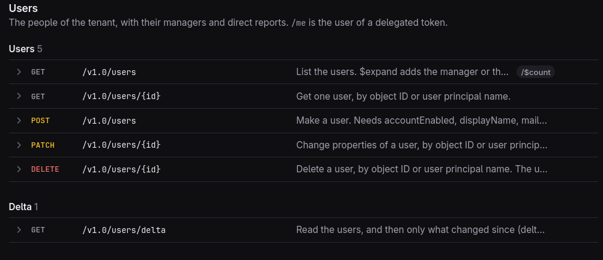
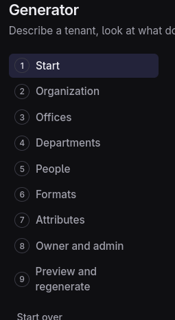
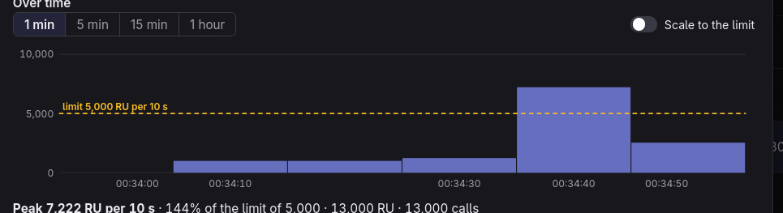
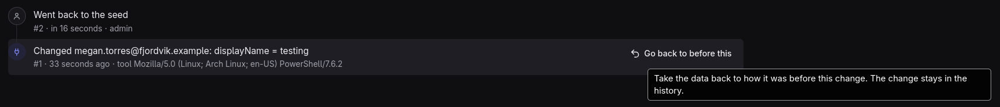

# Fake entra is the best entra

For some time ive had alot of work doing identity management stuff, and a huge part of that work has been management of Entra. 
Entra is the identity management for Microsoft Azure and is the baseline for all identity management for the entire Azure/m365 stack. at the heart of entra is graph api. This is the underlying api for all Entra and partially m365 services (atleast thats the idea, but full service parity for 365 services has yet to be achieved).
Besuase of this its a natrual gateway for automation, as its simple to set up, there is a connector for about every language that i use daily, and its fast enough that i dont feel slowed down by it. 
But it does have some caveats; some endpoints support certain features that others dont, some process your requests in a weird way, some even straight up deny your request if you dont have a extra header value (looking at you ConsistencyLevel=eventual).

However when doing automation, the main thing that has annoyed be about entra/graph is that you dont really have a "dev area" or emulated tenant. Yes you can generate a canary tenant and provide your own data to test large changes, or you could order a demo from microsoft with some seeded services, but this is often tedious work, resetting after testing changes, wondering if you are breaking anything. in both cases you would need to have some sort of script to provide extended data to fit your automation case.

## So i created a graph emulator, i call dollycli

dollycli (Dolly CLI) is made to be as close as a local graph api implementation can be, with the goal of this being able to be used to locally test any automation, and being able to help you create better solutions.

Truth be told, dolly-cli is mostly vibecoded, but im using openapi + odata spec, documentation from microsoft docs and test calls against microsoft own graph explorer instance to validate usage before its added to this application, with the sole purpose of trying to be be as close to a 1:1 representation of what graph would return. i dont guarantee 100% feature parity now, but hopefully this will come.

given the scope of work needed to make a truthfull representation i felt it best that i would let claude make the technical implementation while i test outputs, give corrections where needed, and advice on the workflow and decicions taken so its implemented in a way where one would generate any new routes needed and make sure the implementation is as faithful as possible.

### SSO compliant ish

You can make a webapp that uses this for SSO. corrently only OpenID is supported, but i want to add both SAML and SCIM compliancy, but these features are more advanced so it might take some time.
I have tested with MSAL,@Azure/identity,OIDC-client-ts and openid-client with varying results. these are documented in repo/docs. if you have other tests of other frameworks you have tested, please let me know the results.

### Api Docunmentation

With all the discovery done i also document everything, so we get a easy to read list of all calls that can be done with details of all neccecary odata executions you can do alongside and neccecary headers neede for the calls to work.

### Dataset generation

To be truly helpful, ive also designed in a "tenant profile" where you can go through a wizard to select what the shape of the company looks like, departments, countries in tenant, jobtitles in departments and how people distribute across the organisation (ie 10% of the company is sales and in sales 30% are KAM). etc. This will help you being able to generate a company that are somewhat close to your desired target.

### cost analysis

A not very well represented part of graph, is api cost.

Every serviceprincipal have a set limit of data cost tokens available at any given time and each time they call graph they use these tokens to "pay" for resource usage. this number varias on size of tenant, where the upper limit is at 500 users.

On Graph side there is a rolling window that takes in these tokens and holds them for a given timeframe. when the rolling window is passed, the tokens is returned to the service principals account ready to be reused.

if you go over the limit graph returns a 429 "rate limit" with a retry after header

Because of this complexity and the varying cost of the different queries there is a RU cost view available where you can see the actual cost and where you would break. rate limiting can also be turned on/off.

### call log and "learn" permissions

Any service principal you create comes without permission, and permissions are not enforced. instead dolly reads every call you make and gives you a best guess as to what permission you would need. If you have a already defined permission set, you could add it and dollycli would tell you if you ask for too much, too little and give possible corrections. 

This is great for testing and being able to deliver correct estimates of the needed permissions for your app.

The data from this is gathered from microsoft learn, so it should be mostly correct however the microsoft learn data have some error and weird formatting and we do have some extra steps to make sure that permission dont overlap (ie user read + user update is user.readupdate.all instead of user.read.all + user.readupdate.all).. so this is a best guess, not a guarantee.

Of course, any errors can be reported and i will fix them as soon as i can.

Because the main point if this is not actual permission check i don't have the enforcement, but if you set permissions for your serviceprincipal and run your automation the tool can tell you if your current permission set is correct or if you ask for too much permissions.

### containerized

you can run this in a container as a stand alone service. but please remember, there isnt any password protection anywhere here, its in no way shape or form designed as a identity solution. hell even the sign on pages just have a "select user to sign on as" without password...

### TLS

dollycli runs on plain http by default, and most of the time thats fine. pwsh graph doesnt care (its what [easy connect](#easy-connect) below uses). but MSAL, @azure/identity and the azure cli flat out refuse a plain http authority, so for those you start it with `dolly serve --tls`. it makes a small local CA in the data folder, signs its own cert with it, and you can trust that CA once.

i wasnt comfortable asking you to trust a CA that could sign for anything, so i locked it down. it can only sign for `localhost`, loopback and the hosts you give it, so if the key ever leaks nobody can use it to impersonate a real site. i only verified that with go's verifier though, not with browsers or curl, so dont take my word for those. the CA lives one year, the key stays in your data folder, and `dolly tls remove` deletes it and tells you how to untrust it. its a local dev tool, so please dont put it on a network.

### Reset/Rollback

It supports full auditing history of all items with a button to roll back before a specific change happened. you can also re-regenerate your tenant within the same portal giving you easy way to go back to start.

### Easy connect

I also added easy connect options for powershell where you would only need to run `iwr 'http://127.0.0.1:8650/pwsh' | iex` to connect via powershell graph. ofcourse you could also add the connect profile to your local graph, grab a premade token (honestly any token works, but premade jwt gives you a actual user), and then connect using token. If you have tls enabled the actual connect-mggraph with login should work

### try it out

to try it out you can go to [the github page](https://github.com/WithHolm/dolly-cli). if you are missing endpoints, or there are some odata issues you dont see in the official graph client or suggestions for better QOL, please dont be afraid to open a isssue. all feedback is welcomed.

currently supports users, groups, organization, service principals, permission grants, places, $batch, delta query and /me, with $filter/$orderby/$search/$count checked, and no SAML, SCIM or Azure data plane yet

dollycli is not affiliated with or endorsed by Microsoft. Entra, Azure and Microsoft Graph are trademarks of Microsoft Corporation. Its just a product i really needed, and might think you do too :)
